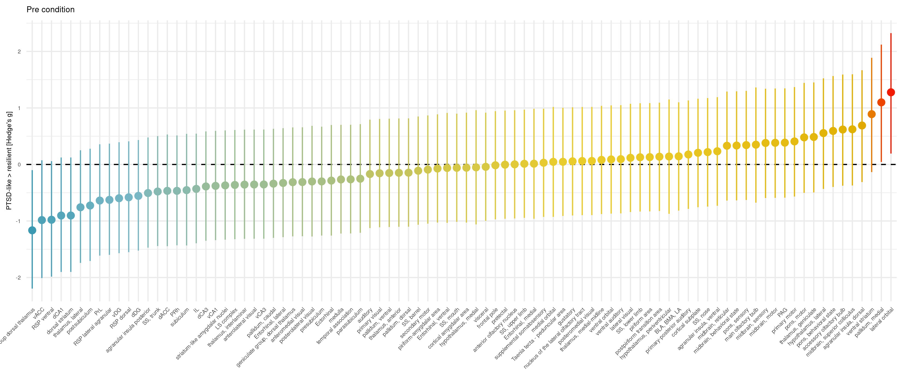
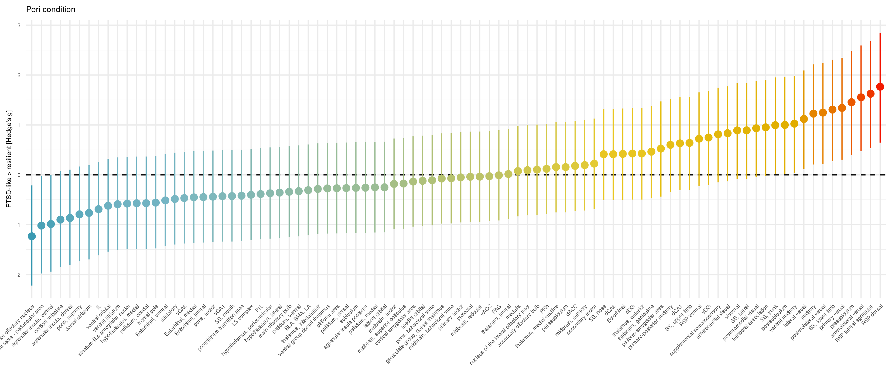
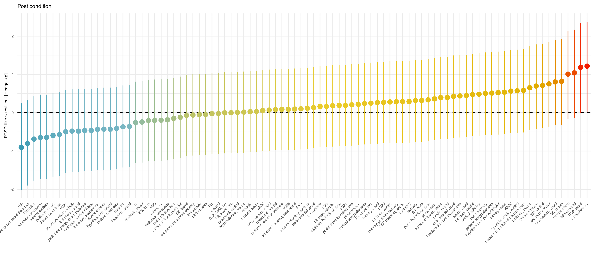

```{r setup, include=FALSE}

knitr::opts_chunk$set(echo = TRUE, 
                      warning = FALSE, 
                      tidy = TRUE, 
                      eval = TRUE, 
                      include = TRUE, 
                      message = TRUE, 
                      results = "hold")
options(knitr.kable.NA = '')

```

## install necessary packages
Run this only once to have packages installed in your environment

```{r, eval=FALSE}
install.packages('tidyverse', 'glue',  'effectsize','wesanderson', 'e1071')
```


## load the packages
```{r load packages, echo = TRUE,  message = FALSE}
#General utility packages
library(tidyverse)
library(glue)

#Stats packages
library(effectsize)

#Plot pacakges
library(wesanderson)
pal <- wes_palette("Zissou1", 100, type = "continuous")

#SVM pacakge
library(e1071)


# read nifti
library(oro.nifti)
library(abind)
```


## Load the tables
```{r load tables, echo = TRUE,  message = FALSE}

pre <- read_csv('assets/table/pre.csv') %>% 
        mutate(ID = as.factor(ID)) %>% 
        mutate(Group = as.factor(Group)) 

peri <- read_csv('assets/table/peri.csv') %>% 
        mutate(ID = as.factor(ID)) %>% 
        mutate(Group = as.factor(Group)) 

post <- read_csv('assets/table/post.csv') %>% 
        mutate(ID = as.factor(ID)) %>% 
        mutate(Group = as.factor(Group))

```

## Making plots for pre conditon
```{r calc effect size pre}
g<-c()
g_lower<-c()
g_upper<-c()

df <-pre

for(i in 3:length(names(df))){
  tmp<-hedges_g(flatten_dbl(df[,i]) ~ Group, data = df)
    g[i-2] <- tmp$Hedges_g
    g_lower[i-2]<- tmp$CI_low
    g_upper[i-2]<- tmp$CI_high
  }

sum_stat <- tibble(ROI = names(peri)[-c(1:2)], g = g, lower = g_lower, upper = g_upper)

plot <- sum_stat %>% 
  mutate(ROI = fct_reorder(ROI, g, min)) %>% 
  ggplot(aes(x=ROI, y=g, colour=g))+
  geom_hline(yintercept = 0, linetype='dashed')+
  geom_pointrange(aes(ymin=lower, ymax=upper))+ 
  theme_minimal()+
  theme(text = element_text(size = 6), axis.text.x = element_text(angle = 45, hjust = 1), legend.position = "none")+
  scale_color_gradientn(colours = pal)+
  labs(y = "PTSD-like > resilient [Hedge\'s g]", title = 'Pre condition', x='')

ggsave(filename='assets/figure/pre_g.png',plot = plot, device = 'png',units = 'mm',dpi = 300,width = 280, height = 120)
  
```



## Making plots for peri conditon
```{r calc effect size peri}
g<-c()
g_lower<-c()
g_upper<-c()

df <-peri

for(i in 3:length(names(df))){
  tmp<-hedges_g(flatten_dbl(df[,i]) ~ Group, data = df)
    g[i-2] <- tmp$Hedges_g
    g_lower[i-2]<- tmp$CI_low
    g_upper[i-2]<- tmp$CI_high
  }

sum_stat <- tibble(ROI = names(peri)[-c(1:2)], g = g, lower = g_lower, upper = g_upper)

plot <- sum_stat %>% 
  mutate(ROI = fct_reorder(ROI, g, min)) %>% 
  ggplot(aes(x=ROI, y=g, colour=g))+
  geom_hline(yintercept = 0, linetype='dashed')+
  geom_pointrange(aes(ymin=lower, ymax=upper))+ 
  theme_minimal()+
  theme(text = element_text(size = 6), axis.text.x = element_text(angle = 45, hjust = 1), legend.position = "none")+
  scale_color_gradientn(colours = pal)+
  labs(y = "PTSD-like > resilient [Hedge\'s g]", title = 'Peri condition', x='')

ggsave(filename='assets/figure/peri_g.png',plot = plot, device = 'png',units = 'mm',dpi = 300,width = 280, height = 120)
  
```



## Making plots for post conditon

```{r calc effect post peri}
g<-c()
g_lower<-c()
g_upper<-c()

df <-post

for(i in 3:length(names(df))){
  tmp<-hedges_g(flatten_dbl(df[,i]) ~ Group, data = df)
    g[i-2] <- tmp$Hedges_g
    g_lower[i-2]<- tmp$CI_low
    g_upper[i-2]<- tmp$CI_high
  }

sum_stat <- tibble(ROI = names(peri)[-c(1:2)], g = g, lower = g_lower, upper = g_upper)

plot <- sum_stat %>% 
  mutate(ROI = fct_reorder(ROI, g, min)) %>% 
  ggplot(aes(x=ROI, y=g, colour=g))+
  geom_hline(yintercept = 0, linetype='dashed')+
  geom_pointrange(aes(ymin=lower, ymax=upper))+ 
  theme_minimal()+
  theme(text = element_text(size = 6), axis.text.x = element_text(angle = 45, hjust = 1), legend.position = "none")+
  scale_color_gradientn(colours = pal)+
  labs(y = "PTSD-like > resilient [Hedge\'s g]", title = 'Post condition', x='')

ggsave(filename='assets/figure/post_g.png',plot = plot, device = 'png',units = 'mm',dpi = 300,width = 280, height = 120)
  
```



## Support vector machine. 

Following the guide from https://www.datacamp.com/community/tutorials/support-vector-machines-r

```{r SVM make model using post, eval=false}

x <- as.matrix(post[,-c(1:2)])
y <- as.factor(post$Group)  

dat = data.frame(x, y = y)
svmfit = svm(y ~ ., data = dat, kernel = "radial", cost = 5, scale = FALSE)
print(svmfit)

post.predict <- predict(svmfit, dat)

detection <- mean(levels(post.predict)[post.predict] == levels(dat$y)[dat$y])
print(glue('Prediction of Post using Post is {detection*100} %'))
```

```{r SVM predict pre, eval=false}

x <- as.matrix(pre[,-c(1:2)])
y <- as.factor(pre$Group)  

dat2 = data.frame(x, y = y)


pre.predict <- predict(svmfit, dat2)

detection <- mean(levels(pre.predict)[pre.predict] == levels(dat2$y)[dat2$y])
print(glue('Prediction of Pre using Post is {detection*100} %'))

```

Prediction isn't really above change level (~ 50%)

```{r SVM predict peri, eval=false}

x <- as.matrix(peri[,-c(1:2)])
y<- peri$Group


dat3 = data.frame(x)


peri.predict <- predict(svmfit, dat3)

#tibble(truth = y, predicted = peri.predict) %>%  kable("pipe")

detection <- mean(levels(peri.predict)[peri.predict] == levels(dat3$y)[dat3$y])
print(glue('Prediction of Peri using Post is {detection*100} %'))

```
Prediction isn't really above change level (~ 50%)


## Voxelwise analysis
```{r peri stats, eval=false}
library(nat)
template <- readNIfTI('assets/nifti/template/template_50.nii.gz')

design <- read_csv('assets/nifti/peri/design.csv')
img <- readNIfTI('assets/nifti/peri/heatmaps_rs_smooth.nii.gz')
mask_img <- readNIfTI('assets/nifti/peri/mask_corr.nii.gz')
stat_img <- mask_img
stat_img_lower <- mask_img
stat_img_upper <- mask_img


mask_bool <- which(mask_img[,,] == 1,arr.ind = TRUE)


img_corr<-c()
for(iter in 1:dim(img)[4]){
  print(iter)
  tmp_img<-img[,,,iter]
  tmp_img<-img[,,,iter]/mean(tmp_img[mask_img==1])
  img_corr<-abind::abind(img_corr,tmp_img, along=4)
}


for(iter  in 1:dim(mask_bool)[1]){
  
i<-  mask_bool[iter,]
g <- hedges_g(img_corr[i[1],i[2],i[3],] ~ design$Group)
stat_img[i[1],i[2],i[3]] <- g$Hedges_g
stat_img_lower[i[1],i[2],i[3]] <- g$CI_low
stat_img_upper[i[1],i[2],i[3]] <- g$CI_high
}


stat_img<-flip(stat_img,3)

writeNIfTI(stat_img,'assets/nifti/peri/peri_effect_corr')
writeNIfTI(stat_img_lower,'assets/nifti/peri/peri_effect_lower')
writeNIfTI(stat_img_upper,'assets/nifti/peri/peri_effect_higher')

```

```{r post stats, eval=false}
template <- readNIfTI('assets/nifti/template/template_50.nii.gz')

design <- read_csv('assets/nifti/post/design.csv')
img <- readNIfTI('assets/nifti/post/heatmaps_rs_smooth.nii.gz')
mask_img <- readNIfTI('assets/nifti/post/mask_corr.nii.gz')
stat_img <- mask_img
stat_img_lower <- mask_img
stat_img_upper <- mask_img


mask_bool <- which(mask_img[,,] == 1,arr.ind = TRUE)


img_corr<-c()
for(iter in 1:dim(img)[4]){
  print(iter)
  tmp_img<-img[,,,iter]
  tmp_img<-img[,,,iter]/mean(tmp_img[mask_img==1])
  img_corr<-abind::abind(img_corr,tmp_img, along=4)
}


for(iter  in 1:dim(mask_bool)[1]){
  
i<-  mask_bool[iter,]
g <- hedges_g(img_corr[i[1],i[2],i[3],] ~ design$Group)
stat_img[i[1],i[2],i[3]] <- g$Hedges_g
stat_img_lower[i[1],i[2],i[3]] <- g$CI_low
stat_img_upper[i[1],i[2],i[3]] <- g$CI_high
}


writeNIfTI(stat_img,'assets/nifti/post/post_effect_corr')
writeNIfTI(stat_img_lower,'assets/nifti/post/post_effect_lower')
writeNIfTI(stat_img_upper,'assets/nifti/post/post_effect_higher')

```


```{r pre stats, eval=false}
template <- readNIfTI('assets/nifti/template/template_50.nii.gz')

design <- read_csv('assets/nifti/pre/design.csv')
img <- readNIfTI('assets/nifti/pre/heatmaps_rs_smooth.nii.gz')
mask_img <- readNIfTI('assets/nifti/pre/mask_corr.nii.gz')
stat_img <- mask_img
stat_img_lower <- mask_img
stat_img_upper <- mask_img


mask_bool <- which(mask_img[,,] == 1,arr.ind = TRUE)

img_corr<-c()
for(iter in 1:dim(img)[4]){
  print(iter)
  tmp_img<-img[,,,iter]
  tmp_img<-img[,,,iter]/mean(tmp_img[mask_img==1])
  img_corr<-abind::abind(img_corr,tmp_img, along=4)
}


for(iter  in 1:dim(mask_bool)[1]){
  
i<-  mask_bool[iter,]
g <- hedges_g(img_corr[i[1],i[2],i[3],] ~ design$Group)
stat_img[i[1],i[2],i[3]] <- g$Hedges_g
stat_img_lower[i[1],i[2],i[3]] <- g$CI_low
stat_img_upper[i[1],i[2],i[3]] <- g$CI_high
}

writeNIfTI(stat_img,'assets/nifti/pre/pre_effect_corr')
writeNIfTI(stat_img_lower,'assets/nifti/pre/pre_effect_lower')
writeNIfTI(stat_img_upper,'assets/nifti/pre/pre_effect_higher')

```